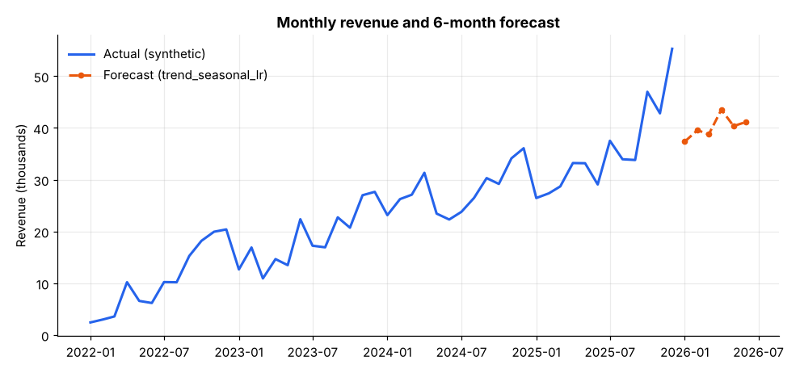
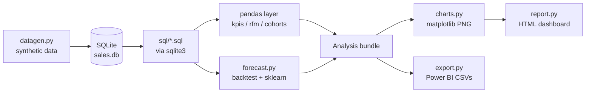
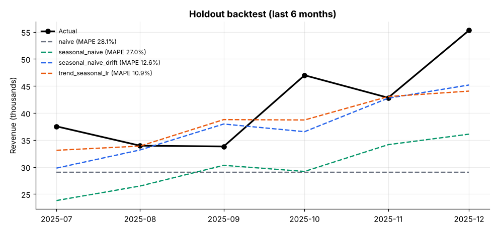
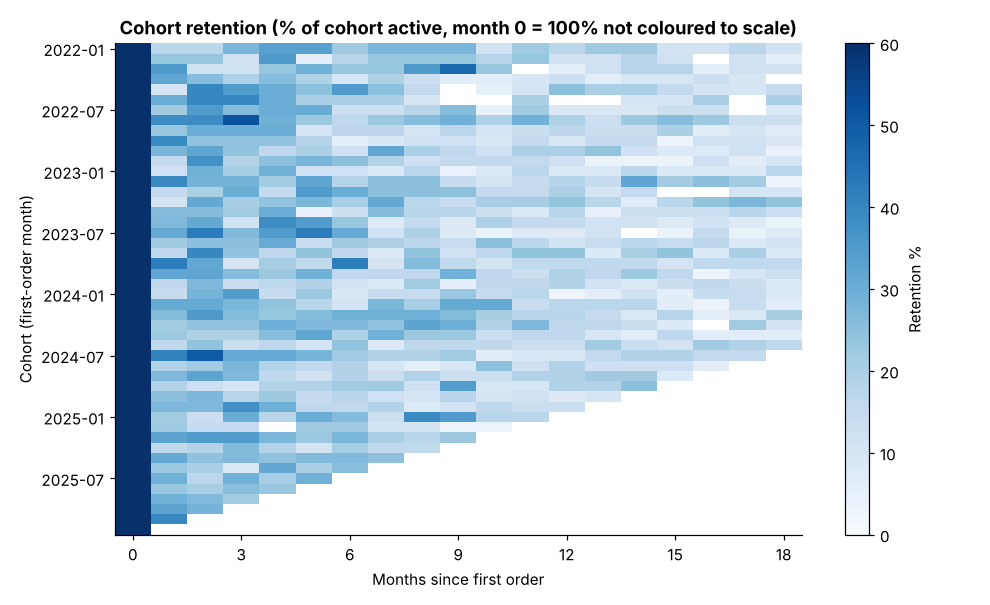
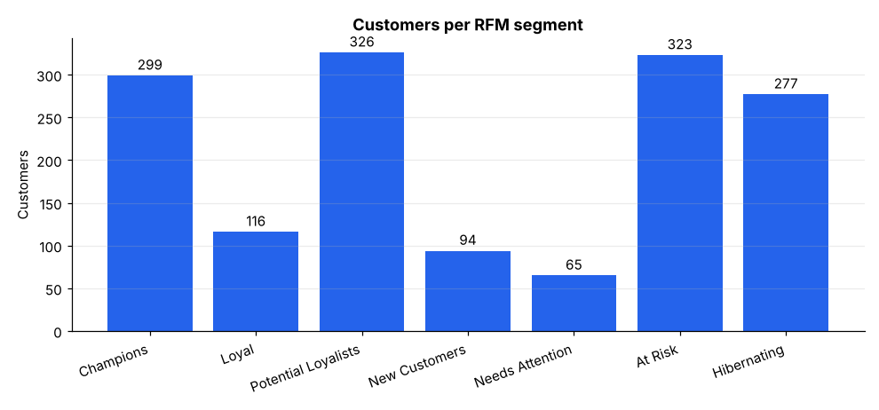
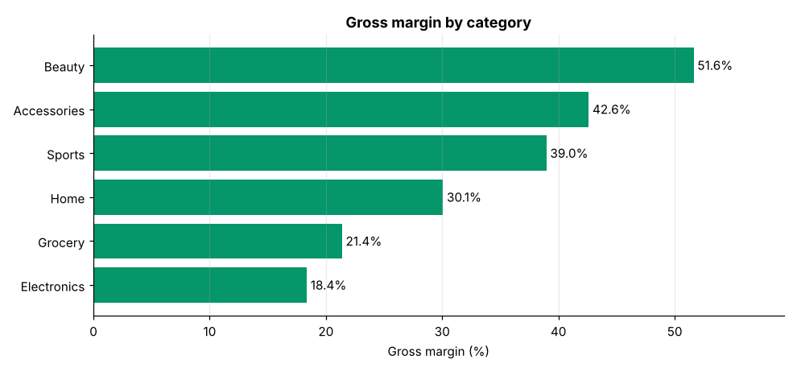
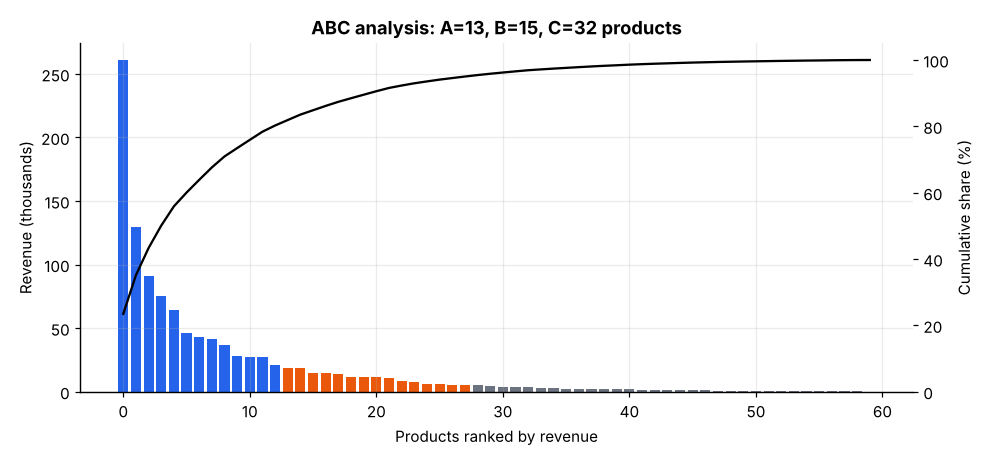

# Sales Intelligence Platform

SQL + pandas sales analytics on a **synthetic** multi-year retail dataset stored in SQLite.
It computes KPIs, RFM customer segments, cohort retention, ABC analysis and a monthly revenue
forecast with an honest holdout backtest, then writes a self-contained HTML dashboard and a
folder of CSV files ready to import into Power BI.

**ملخص بالعربية:** مشروع لتحليل المبيعات على بيانات **اصطناعية** (غير حقيقية) لمتجر تجزئة، مخزّنة في SQLite. يحسب المؤشرات الرئيسية وتقسيم العملاء (RFM) والاحتفاظ بالعملاء (Cohorts) وتحليل ABC وتنبؤًا بالإيرادات مع اختبار رجعي صادق، ثم ينتج لوحة HTML مستقلة وملفات CSV جاهزة للاستيراد إلى Power BI. لا يوجد ملف `.pbix` في المشروع.



## Features

- **Synthetic data generator** (seeded, deterministic): 4 tables, `customers`, `products`, `orders`, `order_items`, 2022-2025.
- **SQL layer** (`sql/*.sql`, run through `sqlite3`): monthly revenue with MoM/YoY growth (window functions), top products, margin by category, RFM base, cohort activity, ABC (Pareto) classification, KPI summary, denormalised fact table.
- **pandas layer:** KPIs, RFM quintile scoring with rule-based segments, cohort retention matrix.
- **Forecasting:** naive, seasonal-naive, seasonal-naive with drift, and a scikit-learn linear trend + month-of-year model, backtested on a holdout with MAPE.
- **Outputs:** self-contained HTML dashboard (inline base64 PNGs, KPI cards, tables, no scripts), PNG charts, CSV export for Power BI plus [`docs/powerbi_import.md`](docs/powerbi_import.md) (suggested relationships and DAX as text).
- CLI (`python -m sales_intel`), logging, type hints, 34 pytest tests.

## Architecture



## Quickstart

```bash
python -m pip install -r requirements.txt   # numpy, pandas, scikit-learn, matplotlib, pytest
python scripts/demo.py                      # generate -> analyse -> charts -> dashboard -> CSV
python -m pytest -q
```

Open `docs/sample_dashboard.html` in a browser. It is generated by the demo and committed as a sample.

## Usage

```bash
python -m sales_intel generate --customers 1500 --seed 42   # build data/sales.db
python -m sales_intel kpis                                  # KPIs as JSON
python -m sales_intel forecast --holdout 6 --horizon 6      # backtest + forecast
python -m sales_intel report --out docs/sample_dashboard.html
python -m sales_intel export --out output/powerbi_csv
python -m sales_intel all                                   # everything above
```

Real output of `python scripts/demo.py` (seed 42, 1,500 synthetic customers):

```text
Wrote data/sales.db: customers=1,500, products=60, orders=7,409, order_items=15,531
Dashboard: docs/sample_dashboard.html
Charts:    docs (7 PNG files)
CSV export: dim_customers.csv=1,500, dim_products.csv=60, dim_date.csv=1,461, fact_order_items.csv=15,531,
            rfm_segments.csv=1,500, cohort_retention.csv=2,256, monthly_revenue.csv=48, forecast.csv=6,
            abc_analysis.csv=60, backtest_metrics.csv=4
{
  "revenue": 1111927.52,
  "orders": 7409,
  "customers": 1500,
  "gross_margin_pct": 30.31,
  "avg_order_value": 150.08,
  "repeat_customer_rate_pct": 73.0,
  "yoy_growth_last_12m_pct": 28.4
}
```

### Forecast backtest (synthetic data, MAPE on held-out months)

```text
Backtest: train on all but the last 6 months, MAPE on the holdout
  trend_seasonal_lr      MAPE  10.86%
  seasonal_naive_drift   MAPE  12.65%
  seasonal_naive         MAPE  26.96%
  naive                  MAPE  28.07%
Best model: trend_seasonal_lr (61.3% lower MAPE than naive)
```

Other holdout sizes (same data): 3 months, `trend_seasonal_lr` 12.83% vs naive 29.31%; 12 months, 11.54% vs naive 18.82%.
**Read this carefully:** the generator itself builds in a smooth growth trend and a fixed monthly seasonality, so a trend + seasonality model is expected to fit well. The result shows the backtest code works, not that the model would forecast a real business. The "best" model is also picked on the same holdout it is scored on, so the headline MAPE is optimistic.



### Other analyses (synthetic data)

| Category | Revenue | Gross margin |
|---|---:|---:|
| Electronics | 574,034 | 18.4% |
| Beauty | 223,303 | 51.6% |
| Accessories | 128,929 | 42.6% |
| Sports | 87,849 | 39.0% |
| Home | 71,993 | 30.1% |
| Grocery | 25,819 | 21.4% |

- **ABC:** 13 products class A (first 80% of revenue), 15 class B, 32 class C.
- **RFM:** 299 Champions (44.0% of revenue), 323 At Risk (25.8%), 277 Hibernating, 326 Potential Loyalists, 116 Loyal, 94 New, 65 Needs Attention.
- **Cohorts:** mean retention across cohorts is 100% at month 0, 25.4% at month 1 and 20.4% at month 6.

| Cohort retention | RFM segments |
|---|---|
|  |  |

| Margin by category | ABC analysis |
|---|---|
|  |  |

## Project structure

```text
sales_intel/   datagen, db, kpis, rfm, cohorts, forecast, analysis, charts, report, export, cli
sql/           schema + 9 query files executed through sqlite3
scripts/       demo.py
tests/         34 pytest tests
docs/          generated PNG charts, sample_dashboard.html, powerbi_import.md
```

## Testing

```bash
python -m pytest -q      # 34 passed
```

Tests cover generator determinism, schema constraints, SQL results vs manual computation (growth, margin, ABC), MAPE and forecast leakage (changing holdout actuals must not change predictions), RFM scoring, cohort matrix, PNG/HTML/CSV outputs and the CLI.

## Limitations

- **All data is synthetic.** Nothing here describes a real business, and no real customers, products or prices are used.
- Forecast accuracy is only demonstrated on generated data with built-in trend and seasonality (see above). Model selection and scoring share one holdout.
- The CSV export is Power BI-ready, but **no `.pbix` exists** and the DAX in `docs/powerbi_import.md` was not run in Power BI Desktop.
- RFM segment rules are simple, hand-written thresholds, not a validated customer model.
- Revenue is in unnamed currency units; no tax, returns or inventory are modelled.

## Roadmap

- Rolling-origin backtesting and prediction intervals.
- Customer lifetime value estimate.
- Load real CSV data through the same SQL schema.

## Built with AI assistance

This project was built with the help of an AI assistant (Claude). The code, tests and README were drafted with AI help; the numbers above are pasted from real runs of the code in this repository. Review it before relying on it.

## License

MIT, see [LICENSE](LICENSE).
